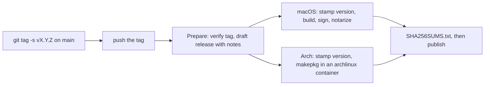

# Releasing

Versioning, the release pipeline, CI, and the one-time repository setup they need.

## Versioning

Ultra 9000 follows [Semantic Versioning](https://semver.org/). While the version is `0.x`, a breaking change bumps the **minor** version (`0.3.2` → `0.4.0`); features and fixes bump the patch version.

**The release tag is the version.** The committed files carry the development placeholder `0.0.0` (`package.json`, which `src-tauri/tauri.conf.json` reads via `"version": "../package.json"`, `src-tauri/Cargo.toml`, the `ultra9000` entry of `src-tauri/Cargo.lock` and `pkgver` in `packaging/arch/PKGBUILD`). The release jobs run `bun scripts/set-version.ts X.Y.Z` on the tagged checkout before building, so artifacts carry the tag's version and no version-bump commit or PR exists. Never edit these versions by hand.

PRs are squash-merged, and the PR title becomes the commit subject on `main`. The `PR title` workflow (`.github/workflows/pr-title.yml`) checks that it is a [Conventional Commit](https://www.conventionalcommits.org/): `feat`, `fix`, `perf`, `refactor`, `docs`, `design`, `style`, `test`, `build`, `ci`, `chore`, `revert`, with an optional scope, and `!` (`feat!: …`) or a `BREAKING CHANGE:` footer for breaking changes. The types drive the release notes and tell you which number to pick:

| Since the last tag                        | Next version (0.x) | Release notes section                                        |
| ----------------------------------------- | ------------------ | ------------------------------------------------------------ |
| a breaking change (`!`)                   | minor              | listed under its type, marked **BREAKING**                   |
| `feat`                                    | minor              | Features                                                     |
| only `fix`, `perf`, `design`, `revert`    | patch              | Bug fixes, Performance, Design, Reverts                      |
| `refactor`, `docs`                        | patch              | Refactoring, Documentation                                   |
| `build`, `ci`, `chore`, `style`, `test`   | —                  | omitted                                                      |

`git cliff --bumped-version` prints the suggested next version locally (`cliff.toml`).

## Release flow



To release the current `main`:

```sh
git switch main && git pull --ff-only
git cliff --unreleased          # review what ships
git tag -s v0.2.0 -m "Ultra 9000 0.2.0"
git push origin v0.2.0
```

Everything else runs in `.github/workflows/release.yml` (workflow "Release"):

1. `Prepare release` requires `vX.Y.Z`, an **annotated tag with a signature GitHub verifies** (your GPG key must be on your GitHub account), and a tagged commit on `main`. It generates notes from the Conventional Commits since the previous tag (`git cliff --current`, `cliff.toml`) and creates a **draft** GitHub release.
2. `macOS (signed, notarized)` and `Arch Linux package` check out the tag, stamp the version, build, and upload their artifacts to the draft.
3. `Checksums and publish` checks that every expected asset is present, uploads `SHA256SUMS.txt`, and publishes the release as Latest.

The release is published only after every job succeeds. If one fails, the release stays a draft. Fix the cause outside the tagged commit (secrets, runner trouble), then rebuild and publish it with:

```sh
gh workflow run release.yml -f tag_name=vX.Y.Z
```

If the fix needs new commits, delete the draft release and its tag (`gh release delete vX.Y.Z --cleanup-tag`) and tag the fixed commit with the next patch version. A published release and its tag are never modified. `.github/rulesets/release-tags.json` blocks moving or deleting `v*` tags once rulesets are available; repository admins bypass it, so only you can clean up a bad tag. The build jobs check out the exact commit `Prepare release` verified, never the tag name again.

### Artifacts

| Asset                                    | Contents                                                                               |
| ---------------------------------------- | -------------------------------------------------------------------------------------- |
| `ultra-9000_X.Y.Z_aarch64.dmg`           | Apple Silicon disk image, Developer ID signed, notarized app inside                    |
| `ultra-9000_X.Y.Z_aarch64.app.tar.gz`    | the same signed, notarized and stapled `Ultra 9000.app` as a tarball                   |
| `ultra-9000-X.Y.Z-1-x86_64.pkg.tar.zst`  | Arch Linux package (`sudo pacman -U ultra-9000-X.Y.Z-1-x86_64.pkg.tar.zst`)            |
| `SHA256SUMS.txt`                         | SHA-256 of every asset above (`sha256sum -c SHA256SUMS.txt --ignore-missing`)          |

The Arch package installs `/usr/bin/ultra9000`, `ultra9000.desktop` (the Wayland app id), hicolor icons named `ultra-9000`, and the licenses under `/usr/share/licenses/ultra-9000/`. To build it from a checkout (nothing is downloaded from GitHub):

```sh
cd packaging/arch && makepkg -si
```

It copies the tracked and untracked-but-not-ignored files into `packaging/arch/src/`, so local changes are included and the working tree's `node_modules/`, `dist/` and `target/` are not touched. A checkout build reports version `0.0.0`.

## Required secrets

| Secret                       | Used by                       | Value                                                          |
| ---------------------------- | ----------------------------- | -------------------------------------------------------------- |
| `SONAR_TOKEN`                | CI → SonarQube Cloud          | SonarQube Cloud token (below); also as a Dependabot secret     |
| `APPLE_CERTIFICATE`          | Release → macOS               | base64 of the Developer ID Application `.p12`                  |
| `APPLE_CERTIFICATE_PASSWORD` | Release → macOS               | the `.p12` export password                                     |
| `APPLE_SIGNING_IDENTITY`     | Release → macOS               | `Developer ID Application: Name (TEAMID)`                      |
| `APPLE_API_ISSUER`           | Release → macOS               | App Store Connect API issuer ID                                |
| `APPLE_API_KEY`              | Release → macOS               | App Store Connect API key ID                                   |
| `APPLE_API_KEY_P8`           | Release → macOS               | contents of `AuthKey_<KEYID>.p8`                               |

Missing secrets fail the job with a message naming them. The macOS job never produces an unsigned build. The release workflow otherwise uses only the built-in `GITHUB_TOKEN`; no personal access token is needed, because nothing in the flow has to trigger another workflow.

### macOS signing and notarization

You need an Apple Developer Program membership. Tauri signs with hardened runtime, notarizes with the App Store Connect API key and staples the ticket. The workflow then checks the app with `codesign --verify --deep --strict`, `spctl --assess` and `xcrun stapler validate`.

**Developer ID certificate** (only the Apple Developer account holder can create one; done here from Linux, no Mac needed)

1. Create a private key and a certificate signing request in a private scratch directory:

```sh
mkdir -p ~/.cache/u9k/apple && cd ~/.cache/u9k/apple && umask 077
openssl genrsa -out developer_id.key 2048
openssl req -new -key developer_id.key -out developer_id.csr \
  -subj "/emailAddress=you@example.com/CN=Your Name"
```

2. At [developer.apple.com → Certificates](https://developer.apple.com/account/resources/certificates/list) click **+**, choose **Developer ID Application**, profile type **G2 Sub-CA**, upload `developer_id.csr` and download `developerID_application.cer`.
3. Bundle certificate, key and Apple's intermediate into a `.p12`. `-legacy` is required: OpenSSL 3's default AES encryption cannot be imported by macOS `security`.

```sh
openssl x509 -inform DER -in developerID_application.cer -out developer_id.pem
curl -fsSLO https://www.apple.com/certificateauthority/DeveloperIDG2CA.cer
openssl x509 -inform DER -in DeveloperIDG2CA.cer -out DeveloperIDG2CA.pem
openssl pkcs12 -export -legacy -inkey developer_id.key -in developer_id.pem \
  -certfile DeveloperIDG2CA.pem -out certificate.p12          # prompts for an export password
openssl x509 -in developer_id.pem -noout -subject           # CN = Developer ID Application: Name (TEAMID)
```

4. Store the secrets (`gh` prompts for single values):

```sh
base64 -w0 certificate.p12 | gh secret set APPLE_CERTIFICATE
gh secret set APPLE_CERTIFICATE_PASSWORD   # the export password
gh secret set APPLE_SIGNING_IDENTITY       # "Developer ID Application: Name (TEAMID)" from the subject
```

Keep `certificate.p12` and its password in your password manager (the key cannot be recovered from Apple), then delete the scratch directory. `*.p12`, `*.p8`, `*.key` and `*.pem` are git-ignored.

**App Store Connect API key (notarization)**

1. Go to App Store Connect → Users and Access → Integrations → App Store Connect API → Team Keys and generate a key with the **Developer** role.
2. Note the **Issuer ID** and the **Key ID**, and download `AuthKey_<KEYID>.p8`. It can be downloaded only once.
3. Store the secrets:

```sh
gh secret set APPLE_API_ISSUER              # issuer ID (UUID)
gh secret set APPLE_API_KEY                 # key ID, e.g. 2X9R4HXF34
gh secret set APPLE_API_KEY_P8 < AuthKey_2X9R4HXF34.p8
```

The workflow writes the key to `$RUNNER_TEMP/AuthKey_<KEYID>.p8`, exports `APPLE_API_KEY_PATH` for Tauri, and deletes the file at the end of the job.

**Entitlements**

`src-tauri/Entitlements.plist`, referenced by `bundle.macOS.entitlements`, is intentionally an empty dictionary. Hardened runtime needs no exceptions here:

- No JIT or unsigned executable memory. WKWebView's JavaScript JIT runs in Apple's own WebContent process, and Alacritty's OpenGL renderer uses only system frameworks.
- Library validation stays on. Only system frameworks and the app's own code are loaded, with no plugins or third-party dylibs.
- No Apple Events. Notifications run `osascript` with `display notification`, a scripting addition executed inside `osascript` that targets no other app.
- No sandbox. A terminal host must spawn arbitrary shells and tools in PTYs, so the app is distributed with Developer ID outside the Mac App Store.

Known limitation: macOS attributes privacy (TCC) requests from programs running in a terminal to the terminal app. Tools started inside Ultra 9000 that need the camera, microphone or Apple Events are therefore denied. Supporting them needs both the matching entitlements (`com.apple.security.device.camera`, `com.apple.security.device.audio-input`, `com.apple.security.automation.apple-events`) and `NS*UsageDescription` strings in the app's `Info.plist`.

## SonarQube Cloud

Analysis runs in CI. The `SonarQube Cloud` job compiles nothing: it scans the sources with three coverage reports passed as workflow artifacts: Rust from `Rust (Linux)` (`lcov.info`) and `Rust (macOS)` (`lcov-macos.info`, the only one that covers `macos.rs`), both `cargo llvm-cov` over the app crate's unit tests and its real-runtime GUI tests (`src-tauri/tests/gui_linux.rs` under a headless sway, `gui_macos.rs` in the runner's window server session; `U9K_REQUIRE_GUI_TESTS=1` makes a skip fail) with repo-relative paths, and TypeScript from `Frontend` (Vitest, `coverage/lcov.info`). Sonar merges the two Rust reports per line. **Coverage counts production lines only, with no exclusions**: Rust tests live in dedicated `tests.rs` / `test_support.rs` module files (never inline in production files) and in `src-tauri/tests/`, which are classified as test code and left out of the reports; frontend tests are `src/**/*.test.ts` with helpers in `src/test/`. Every production file counts, including the startup in `lib.rs`, the platform hosts `linux.rs` / `macos.rs` and `src/main.ts`. Clippy and ESLint gate CI themselves (any finding fails the build), so their reports are not imported. Sonar has no Svelte analyzer, so `.svelte` components are not analysed by Sonar; `svelte-check` and ESLint with `eslint-plugin-svelte` cover them in CI. The configuration is in `sonar-project.properties`.

One-time setup:

1. In SonarQube Cloud, organization `yasen-pavlov`, go to **Analyze new project** and import `ultra_9000`. The project key must be `yasen-pavlov_ultra_9000`.
2. Project → Administration → Analysis Method: turn **Automatic Analysis off**. CI-based and automatic analysis cannot run together.
3. Create a token (My Account → Security, or a project analysis token) and store it:

```sh
gh secret set SONAR_TOKEN                  # Actions
gh secret set SONAR_TOKEN --app dependabot # Dependabot PRs read secrets from their own store
```

4. Quality gate: the project uses "Sonar way" (80% coverage on new code, A ratings, no unreviewed hotspots). The scan sets `sonar.qualitygate.wait=true`, so a failed gate fails the `SonarQube Cloud` job and with it `CI ok`.
5. New code definition: *Previous version* does not apply because the analysis sets no `sonar.projectVersion`. Use *Reference branch* `main` or a number of days.

The scan is skipped for fork PRs, which receive no repository secrets. Dependabot PRs use the Dependabot copy of `SONAR_TOKEN`. On all other events a missing `SONAR_TOKEN` fails the job, and with it `CI ok`. PRs without native changes skip `Rust (Linux)`, so their scan has no Rust coverage (they change no Rust lines); pushes to `main` always include it.

## Repository settings and branch protection

Merge settings (squash only, PR title as the commit subject, delete merged branches):

```sh
gh api -X PATCH repos/yasen-pavlov/ultra_9000 \
  -F allow_squash_merge=true -F allow_merge_commit=false -F allow_rebase_merge=false \
  -f squash_merge_commit_title=PR_TITLE -f squash_merge_commit_message=PR_BODY \
  -F delete_branch_on_merge=true
gh api -X PUT repos/yasen-pavlov/ultra_9000/actions/permissions/workflow \
  -f default_workflow_permissions=read -F can_approve_pull_request_reviews=false
```

Two rulesets are committed and applied to the repository:

- `.github/rulesets/main.json`: blocks deletion and force pushes on `main`, requires linear history and a PR (0 approvals, stale reviews dismissed, conversations resolved, squash only), and requires the `CI ok` and `PR title` checks from GitHub Actions with the branch up to date.
- `.github/rulesets/release-tags.json`: `v*` tags cannot be moved or deleted (repository admins can bypass it to clean up a bad tag), so a published release always points at the same commit.

Apply them to a new repository with:

```sh
gh api -X POST repos/yasen-pavlov/ultra_9000/rulesets --input .github/rulesets/main.json
gh api -X POST repos/yasen-pavlov/ultra_9000/rulesets --input .github/rulesets/release-tags.json
```

To change it later, edit the file and `gh api -X PUT repos/yasen-pavlov/ultra_9000/rulesets/<id> --input .github/rulesets/main.json` (`gh api repos/yasen-pavlov/ultra_9000/rulesets` lists the id).

## CI job map

`.github/workflows/ci.yml` runs on pull requests (opened, synchronize, reopened) and on pushes to `main`. Superseded PR runs are cancelled. Editing a PR title or body does not re-run it; `.github/workflows/pr-title.yml` (job `PR title`, also a required check) re-checks the title on `edited`.

| Job                 | Runs                                                                                                             | When                                                          |
| ------------------- | ---------------------------------------------------------------------------------------------------------------- | ------------------------------------------------------------- |
| `Detect changes`    | path filters (`native`: `src-tauri/`, `vendor/`, `ci.yml`; `packaging`)                                          | always                                                        |
| `Frontend`          | `bun install --frozen-lockfile`, `check`, `lint`, `format:check`, `build`, `bun audit --audit-level=high`, Vitest with coverage (LCOV artifact) | always                  |
| `Rust (Linux)`      | `cargo fmt --check`, `clippy --all-targets -D warnings`, app crate tests with coverage (LCOV artifact) including the GUI test under a headless sway (`WLR_BACKENDS=headless`, pixman) on a private session bus, tests `alacritty_embed`, `alacritty_terminal`, `vte-graphics` | pushes to `main`; PRs with native changes |
| `Rust (macOS)`      | Clippy and the same tests on Apple Silicon, the GUI test in the runner's window server session (includes `drop_stops_foreground_job_ignoring_hangup`) | pushes to `main`; PRs with native changes                     |
| `MSRV`              | `cargo check --all-targets` with the `rust-version` read from `src-tauri/Cargo.toml`                              | pushes to `main`; PRs with native changes                     |
| `cargo-deny`        | advisories, licenses, bans, sources per `deny.toml`                                                              | always                                                        |
| `Workflow lint`     | actionlint and zizmor on `.github/`                                                                              | always                                                        |
| `Arch package`      | `packaging/arch/container-build.sh` (the release's makepkg path) in the pinned archlinux container, no upload    | only if `packaging/`, `release.yml` or `ci.yml` changed       |
| `SonarQube Cloud`   | scan with the artifacts above                                                                                    | pushes and same-repository PRs (including Dependabot)         |
| `CI ok`             | fails if any job above failed or was cancelled (skipped is fine)                                                 | always; required check                                        |

The Rust jobs build the frontend first, because `tauri::generate_context!` embeds `dist/`. The vendored crates have no committed lockfiles, so CI seeds them from `src-tauri/Cargo.lock` and they are tested against the versions that ship.

Build speed: the Rust jobs append `CI_CARGO_PROFILE` (in `ci.yml`) to `$CARGO_HOME/config.toml`, which compiles dependencies at `opt-level = 0` without debug info instead of the manifest's `opt-level = 3` (meant for interactive terminal speed); config-file profiles take precedence over `Cargo.toml`. The Rust build cache (`Swatinem/rust-cache`) is written only by `main` runs and restored by PRs, so the first PR after a dependency change compiles cold.

Local equivalents of the supply-chain checks:

```sh
cargo deny --manifest-path src-tauri/Cargo.toml check   # deny.toml at the repository root
actionlint
zizmor .github
```

### Pinned tooling

Third-party actions are pinned by commit SHA (version in a trailing comment), and Dependabot (`.github/dependabot.yml`) updates them weekly together with the Cargo and Bun dependencies, after a 7-day cooldown. Dependabot does not track the remaining pins, which are updated by hand:

- the `archlinux:base-devel` container image in `release.yml` and `ci.yml` (tag plus digest; the jobs run `pacman -Syu` anyway)
- actionlint (version and SHA-256 in `ci.yml`)
- zizmor and cargo-llvm-cov (versions in `ci.yml`)
